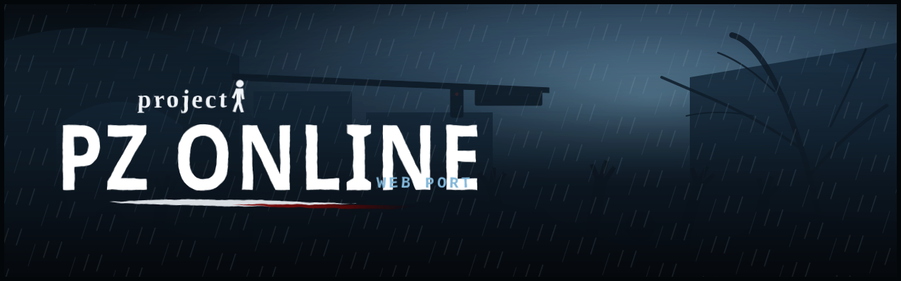
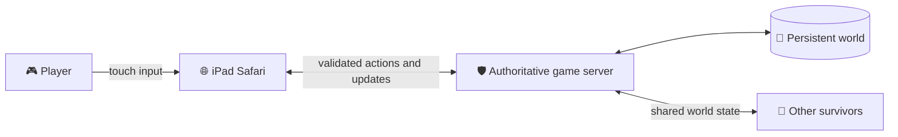

<div align="center">


**A planned browser-based port for iPad — survive together, straight from Safari.**


*The Knox Country outbreak. A touchscreen. Your story.*

</div>

---

## The vision

PZ Online aims to bring a **multiplayer Project Zomboid experience to the iPad as a web-based game**. The goal is to make it playable in Safari with touch-first controls, while preserving the tension, teamwork, and unpredictable survivor stories that make the game compelling.

No app or playable build exists yet. This repository is in the planning stage; the features below are design goals, not promises of what is already implemented.

> **Unofficial fan project:** PZ Online is not affiliated with or endorsed by The Indie Stone. Project Zomboid and its related marks belong to their respective owners. Any implementation and distribution must respect the rights of the original creators.

## Built for the iPad

| 👆 Touch first | 🌐 Runs in the browser | 📱 Mobile-ready |
| --- | --- | --- |
| Large, accessible controls with no keyboard requirement. | The target is Safari on iPad 10, with no native app install required. | Designed for unstable connections, reconnection, and iPad performance. |

## Multiplayer, by design

The planned experience follows a server-authoritative model: the server—not the player's device—decides important game outcomes.



The diagram describes the intended direction, not a finished architecture.

### Design priorities

- **Fair multiplayer:** Server-owned decisions for damage, inventory, loot, health, skills, crafting, and item ownership.
- **Reliable sessions:** Reconnection support and resilience to unstable mobile internet.
- **Safe by default:** Validate user input, protect secrets, prevent item duplication, rate-limit sensitive actions, and log administrative actions.
- **iPad performance:** Target iPad 10 Safari; use chunk streaming and object pooling where appropriate, and profile before optimizing.
- **Accessible controls:** Touch-first interactions, generous hit areas, and accessibility support.

## Roadmap

```text
PLAN                 PROTOTYPE                PLAYTEST
Define the scope  →  Build a small slice  →  Test on real iPads
```

- [x] Write down the project goals and engineering guidelines
- [ ] Define the first playable milestone
- [ ] Choose the technical architecture and project license
- [ ] Prototype touch controls and the browser game loop
- [ ] Build multiplayer and persistence in testable milestones
- [ ] Test reconnection, multiplayer edge cases, and real iPad performance

Progress will be driven by stability and verified testing—not feature count.

## Get involved

The project is early, so thoughtful feedback on scope, iPad controls, and the multiplayer experience is especially useful. Open an issue or start a discussion to share ideas.

The current engineering principles are in [`PZ Online iPad/ai_guidelines.txt`](PZ%20Online%20iPad/ai_guidelines.txt). Code contributions can follow once the initial architecture, license, and contribution workflow are established.

## Open source

Open development is the goal, but **the repository does not have a license yet**. A license is needed before others can confidently reuse, modify, or distribute the project. Choosing one and documenting the contribution process are early milestones.

---

<div align="center">

**A small screen. A big world. Nobody survives alone.**

</div>
